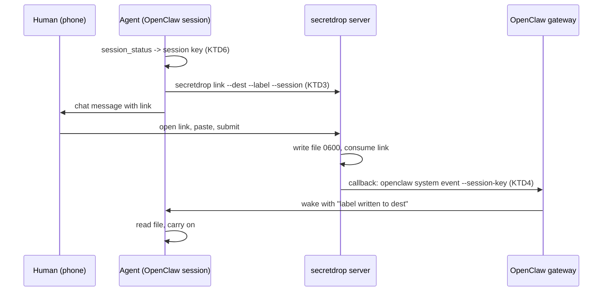
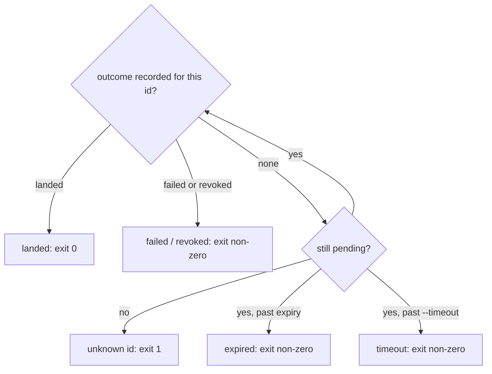

# secretdrop agent skill and launch README - Plan

## Goal Capsule

- **Objective:** someone who sees the LinkedIn post can open the repo, understand secretdrop from the first screen, install it into Claude Code, Codex or OpenClaw with one line, and get their first secret from phone to file by asking their agent.
- **Means:** one Agent Skill shipped from this repo (KTD1), a per-link OpenClaw session (KTD3), and a rewritten README with new artwork (KTD7).
- **Product authority:** the Product Contract below. The repo owner decides anything it leaves open.
- **Deadline:** live before the LinkedIn post on 2026-10-16.
- **Stop conditions:** stop and ask if a host's install path turns out not to load the skill, or if the OpenClaw `system event` wake cannot reach a non-main session on the owner's install.
- **Execution profile:** tests first for the Python changes (U1, U2, U3); smoke verification for packaging, the skill, artwork and docs.
- **Who finishes:** the implementer builds U1–U8; the repo owner captures the Telegram half of the hero image, runs `clawhub login` and publishes, and runs the end-to-end drop on the Pi.
- **Open blockers:** none.

---

## Product Contract

Product Contract preservation: changed only by removing the Outstanding Questions section, whose four planning questions are answered by KTD3, KTD1, KTD5 and Deferred to Follow-Up Work, and by adding the verified skill-format fact to Dependencies.

### Summary

secretdrop ships as one agent skill that Claude Code, Codex and OpenClaw each install in one line. The skill teaches an agent to set secretdrop up on a machine that lacks it, and to request a secret from a human through a one-time link so the value never enters the chat. In OpenClaw, the session that asked for a secret is the one woken when it lands. The repo gets an SVG icon, a banner, a hero image and a README rewritten for a human reader.

### Problem Frame

secretdrop works today, but only for someone who clones the repo, reads a long reference-style README, writes a config by hand and wires up a callback. Agents don't know it exists unless their owner tells them. The README opens on the mechanism and the threat model, so a reader arriving from a social post has to read several screens before seeing what it does for them, and there is no image anywhere.

The OpenClaw integration has a specific gap. The wake script reads the session to wake from one fixed setting in the service environment (`examples/openclaw-wake.sh`), so every drop wakes the same session regardless of which agent asked.

### Key Decisions

- **One skill, three hosts.** The skill is written once in the open Agent Skills format and installed into each host from this repo. It keeps one artifact to maintain and one story for the post. Governs R1, R2. (session-settled: user-directed — chosen over a PyPI release, a README-only launch, and an added MCP server: a skill plus README is what fits before the post.)
- **The agent performs first-run setup.** A reader goes from install to first drop by asking their agent. Governs R5, R6. (session-settled: user-directed — chosen over pointing the user to the README or printing a checklist for the user to run: the shortest path from post to working drop.)
- **The CLI stays a git install for this launch.** A PyPI release would shorten the install, but it adds a release step before the post. Governs R5.
- **The agent proposes the allowlist and the human approves it.** The allowlist is the guard against a confused or compromised agent, so the agent must not set its own limits unseen. Governs R6. (session-settled: user-approved — proposed over the agent writing the allowlist on its own: the allowlist exists to constrain the agent.)
- **Claude Code and Codex wait and check, and the README says so.** Those hosts have no way for secretdrop to wake a session, so they get no push wake-up, and the post should not imply one. Governs R10. (session-settled: user-approved — accepted over building a wake mechanism for those hosts in this launch.)
- **The README follows the shape of `flaviocopes/architecture-dissector`.** It opens on a banner, then two plain paragraphs, numbered setup with a paste-this prompt, one image per idea, a command table, and a plain-words section on what it protects. Governs R15–R17.
- **The hero image shows an OpenClaw Telegram chat beside the drop page on a phone.** It is the real use case: the agent lives on another machine and the human is on their phone. Governs R13. (session-settled: user-directed — chosen over a phone-only capture, a three-step strip, a GIF, and a Claude Code or Codex terminal as the chat side.)
- **Artwork ships in light and dark versions, each rebuilt by a script in the repo.** Following the example README, the images can be regenerated when the page or icon changes. Governs R11, R12, R14. (session-settled: user-approved — proposed alongside the icon request and confirmed.)

### Actors

- A1. The human: owns the secret, reads the link on their phone, approves the allowlist.
- A2. The agent: Claude Code, Codex or an OpenClaw session. It needs a secret, makes the link, and reads the file afterwards.
- A3. The secretdrop server: serves the link, writes the file, fires the callback.

### Requirements

**The skill and its installation**

- R1. One skill works unchanged on Claude Code, Codex and OpenClaw.
- R2. Each host has a single install command or step, shown in the README, that installs the skill from this repo; Claude Code installs it through its plugin marketplace.
- R3. The skill applies whenever the agent needs a credential it does not have. The agent never asks for the value in chat and offers a link instead.
- R4. To request a secret, the agent picks a destination inside the allowlist, makes a link with a label the human will recognise, sends the link, and once the secret lands uses the file without printing its value.

**First-run setup**

- R5. When secretdrop is not installed or not running, the agent offers to set it up: install the CLI, write a config, start the server so it survives a reboot on Linux and macOS, and confirm the link address is reachable over Tailscale.
- R6. The agent shows the human the allowlist it proposes and saves it only after the human approves it.
- R7. Setup finishes with a test drop the human completes from their phone, so both sides know the path works.

**OpenClaw wake**

- R8. Each link remembers the OpenClaw session that requested it, and that session is the one woken when the secret lands.
- R9. A link made without a session behaves as it does today.
- R10. On Claude Code and Codex, the agent waits for the secret to land by checking for it, and the README states that only OpenClaw is woken automatically.

**Artwork**

- R11. secretdrop has an SVG icon that reads clearly at favicon size and in the README header, in light and dark versions.
- R12. A banner combines the icon, the name and a one-line tagline, in light and dark versions, and opens the README.
- R13. A hero image shows an OpenClaw agent on Telegram asking for a bot token and posting the link, next to the drop page open on a phone.
- R14. The drop page screenshot, icon and banner can each be rebuilt from a script in the repo.

**README**

- R15. The README follows this order: banner, two short paragraphs on what secretdrop does for you, install per host, numbered setup that includes a sentence to paste to your agent, how a drop works with the hero image, what it protects you from, a command table, and the license.
- R16. Configuration keys, callback variables, the full threat model and the test command move to a linked reference doc, with nothing removed.
- R17. README prose is second person, plain, and in short sentences, and a reader who has never heard of Tailscale learns in one sentence what they need.

### Key Flows

- F1. First run from the post
  - **Trigger:** a reader installs the skill and asks their agent to set up secretdrop.
  - **Actors:** A1, A2, A3
  - **Steps:** the agent finds secretdrop missing, installs it, proposes an allowlist, the human approves it, the agent starts the server and sends a test link, and the human opens it on their phone and submits a dummy value.
  - **Outcome:** the server is running, the allowlist is saved, and the test drop has landed.
  - **Covered by:** R5, R6, R7
- F2. Agent needs a secret
  - **Trigger:** the agent reaches a step that needs a credential it does not have.
  - **Actors:** A1, A2, A3
  - **Steps:** the agent makes a link with a label and destination and sends it in chat. The human opens it on their phone and pastes the value. The server writes the file and fires the callback, and the agent is woken (OpenClaw) or sees the drop has landed (Claude Code, Codex) and continues.
  - **Outcome:** the file holds the secret, the chat holds only the link, and the agent carries on.
  - **Covered by:** R3, R4, R8, R10

### Acceptance Examples

- AE1. **Covers R8.** Given two OpenClaw sessions, one in a Telegram group and one in a DM, when the group session requests a token and the human submits it, the group session is woken and the DM session is not.
- AE2. **Covers R9.** Given a link made from the command line with no session, when the human submits it, the callback behaves exactly as it does before this change.
- AE3. **Covers R3.** Given a human who starts typing a token into the chat, when the agent sees a request for one, it sends a drop link and asks for the value there.
- AE4. **Covers R6.** Given first-run setup, when the human rejects the proposed allowlist, nothing is saved and the agent asks what to allow instead.

### Success Criteria

- A reader who knows nothing about secretdrop understands what it does from the banner, the first two paragraphs and the hero image, without scrolling further.
- Someone else follows the README from a clean machine to a first successful drop through their agent, with no step outside the README.

### Scope Boundaries

- No MCP server.
- No PyPI release. The CLI installs from git.
- No listing on a public skill directory beyond what the install lines need.
- No wake-up mechanism for Claude Code or Codex sessions.
- No changes to the drop page's behaviour or to the security model.

#### Deferred to Follow-Up Work

- The new icon as the drop page's favicon (R11 only requires the README and repo icon).
- A copy of `SKILL.md` at the repo root for `openclaw skills install git:Rendiere/secretdrop`; ClawHub and `npx skills add` cover OpenClaw without it.

### Dependencies / Assumptions

- The hero image needs a real capture of an OpenClaw Telegram chat from the machine that runs OpenClaw, which is not the development laptop. If no capture is possible in time, the chat side is recreated faithfully from a real exchange, and the phone side stays a real capture of the drop page.
- Claude Code, Codex and OpenClaw all load skills in the Agent Skills `SKILL.md` format, which needs only `name` and `description` in its frontmatter.

### Sources / Research

- `examples/openclaw-wake.sh`: the wake script reads one fixed `SECRETDROP_SESSION` for every drop.
- `secretdrop/callback.py`: the callback carries five metadata variables and never the value; R8 adds a session to that metadata.
- `secretdrop/cli.py`: `link` takes `--dest`, `--label`, `--mode`, `--key`, `--ttl`, `--json`, and has no way to attach a session today.
- `secretdrop/pages.py`: renders the drop page used for the screenshot.
- `https://github.com/flaviocopes/architecture-dissector`: the README shape the rewrite follows.

---

## Planning Contract

### Key Technical Decisions

- KTD1. **The skill lives at `skills/secretdrop/`, and the README leads with `npx skills add Rendiere/secretdrop`.** The cross-agent `skills` CLI installs into Claude Code, Codex and OpenClaw from that layout in one line. Under it, the README gives the native Claude Code pair (`/plugin marketplace add Rendiere/secretdrop`, then `/plugin install secretdrop@secretdrop`) and ClawHub's `openclaw skills install @rendiere/secretdrop`. Codex's `$skill-installer` with the tree URL goes in the reference doc. Governs R1, R2. (session-settled: user-approved — chosen over a second `SKILL.md` at the repo root for OpenClaw's git installer: one copy of the skill.)
- KTD2. **The repo is its own Claude Code marketplace.** `.claude-plugin/marketplace.json` lists one plugin with `source: "."`, and `.claude-plugin/plugin.json` names it `secretdrop`. The plugin then loads `skills/secretdrop/` by the standard layout. Governs R2.
- KTD3. **A link carries an optional OpenClaw session key, set with `secretdrop link --session <key>`.** The key is stored on the pending link. The callback exports it as `SECRETDROP_SESSION` only when the link has one, so a deployment that sets `SECRETDROP_SESSION` in its service environment keeps that as the default. The webhook payload carries `session`, null when absent. The key is validated against a narrow character set (letters, digits, `:._@+-`, at most 200 characters), because it reaches a shell script. Governs R8, R9.
- KTD4. **The wake script calls `openclaw system event --session-key <key> --mode now`.** The current script's `openclaw cron create --session-key` flag does not exist in OpenClaw 2026.10.3, and cron system events reach only the main session. `system event` with a session key wakes that session immediately. When a gateway restart drops the event, the skill's fallback is to check the destination file. Governs R8. (session-settled: user-approved — the lost-on-restart gap was accepted over building a retry.)
- KTD5. **A new `secretdrop wait <id>` command blocks until a link ends, then reports how it ended.** The server records each link's outcome (`landed` after a successful write, `failed` after a failed write, `revoked` from `secretdrop revoke`) in the state file, keyed by link id and kept for 24 hours. `wait` reads that record instead of inferring from file times, so a re-run after the drop finished still gets the right answer. It reports `expired` as soon as a still-pending link passes its expiry, and `timeout` when `--timeout` passes first. Exit status is 0 only for `landed`. `--timeout` and `--json` are supported, and the id accepts a unique prefix like `revoke`. Governs R10, R7. (session-settled: user-approved — chosen over the skill polling `secretdrop list --json` itself: one reliable step for the agent.)
- KTD6. **An OpenClaw agent finds its own session key with its `session_status` tool (`sessionKey="current"`).** No environment variable exposes it to the shell. A sub-agent without that tool makes the link without `--session` and the main session is woken. Governs R8.
- KTD7. **Artwork is SVG authored by hand plus PNGs rendered by `scripts/render-assets.sh` with headless Chrome.** The icon is a pair of SVGs (light and dark) with no text, so they render the same everywhere. The banner, drop-page screenshots and hero composition are HTML pages rendered to PNG at 2x, because text inside an SVG shown as an image on GitHub falls back to system fonts. This adds no Python dependency, but regenerating needs Chrome installed. Governs R11, R12, R13, R14. (session-settled: user-approved — chosen over adding Playwright or another render dependency.)
- KTD8. **First-run setup lives in a reference file the skill loads only when needed.** `SKILL.md` stays short and covers the request flow. `references/setup.md` covers install with `uv tool install` (falling back to `pipx`, then `pip install --user`), the config, a systemd user unit on Linux or a launchd agent on macOS, and the test drop. Governs R5, R6, R7.
- KTD9. **Setup widens the service sandbox to match the approved allowlist.** The example systemd unit only permits writes under `~/.openclaw` (`ReadWritePaths`), and `ReadWritePaths` takes no wildcards and fails on a missing path. For each approved entry, setup takes the longest leading directory with no wildcard segment, creates it at mode 0700, and adds it to `ReadWritePaths`. Setup refuses an entry whose leading directory would be `$HOME` itself and asks the human to narrow it. This leaves the security model unchanged: the allowlist stays the rule for where secrets go, and the sandbox only stops refusing writes the allowlist already permits. Governs R5, R6.

### High-Level Technical Design

The sequence below shows a drop requested by an OpenClaw session. On Claude Code and Codex the last two steps are replaced by the agent running `secretdrop wait`.



`secretdrop wait` decides its outcome on each poll as follows (KTD5):



### Output Structure

```text
.claude-plugin/
  marketplace.json
  plugin.json
skills/secretdrop/
  SKILL.md
  references/setup.md
docs/
  reference.md
  assets/
    icon-light.svg, icon-dark.svg
    banner.html, banner-light.png, banner-dark.png
    drop-light.png, drop-dark.png
    hero.html, hero.png, telegram.png
examples/
  com.secretdrop.serve.plist
scripts/
  render-assets.sh
```

### Assumptions

- `npx skills add` keeps installing into the three hosts' global skill directories as documented in `vercel-labs/skills` on 2026-10-15.
- Headless Chrome can render the light and dark colour schemes of the drop page; the exact flag is found during U6.

---

## Implementation Units

### U1. Per-link session on links and callbacks

**Goal:** a link can carry an OpenClaw session key that reaches the callback.

**Requirements:** R8, R9, AE1, AE2; KTD3.

**Dependencies:** none.

**Files:**
- `secretdrop/store.py`
- `secretdrop/cli.py`
- `secretdrop/callback.py`
- `secretdrop/paths.py` (only if the validator lives beside `check_text`)
- `tests/test_store.py`, `tests/test_cli.py`, `tests/test_callback.py`

**Approach:**
1. Add an optional `session` field to `DropRequest`, defaulting to none, so records written before this change still load.
2. Add `--session` to `link`, validated per KTD3 before the link is stored, and include `session` in `link --json` and `list --json`.
3. Export `SECRETDROP_SESSION` from `callback_env` only when set, and add `session` to the webhook payload.

**Execution note:** write the store back-compat and callback tests first.

**Patterns to follow:** `check_text` in `secretdrop/paths.py` for input validation; `make_request` in `tests/test_callback.py`.

**Test scenarios:**
- A pending-store file written without a `session` key loads, lists and consumes normally.
- `link --session agent:main:telegram:group:-100123` stores the key, and `list --json` shows it.
- `link --session` with a space, a quote, `$(...)`, a newline or 201 characters exits 2 and stores nothing.
- Covers AE1. A request with a session yields `SECRETDROP_SESSION` equal to that key in the callback environment.
- Covers AE2. A request without a session yields exactly the five existing variables, and a `SECRETDROP_SESSION` already in the parent environment reaches the command unchanged.
- The webhook payload carries `session` as the key, or null, and still has no value field.

**Verification:** the full unittest suite passes, including the updated "only the documented variables" test.

### U2. `secretdrop wait`

**Goal:** an agent without a wake-up can block until its link ends and learn whether the secret landed.

**Requirements:** R10, R7; KTD5.

**Dependencies:** U1 (shares the CLI changes).

**Files:**
- `secretdrop/store.py`
- `secretdrop/server.py`
- `secretdrop/cli.py`
- `tests/test_store.py`, `tests/test_server.py`, `tests/test_cli.py`

**Approach:**
1. Give the store a second map in the same state file for outcomes (id, outcome, time), written under the existing lock and purged after 24 hours. Older state files without it load as empty.
2. The server records `landed` after `write_secret` succeeds and `failed` when it raises. `revoke` records `revoked`. Outcomes hold the id, outcome and time only, never the value.
3. `wait` resolves the id or unique prefix across pending links and recorded outcomes, then polls per the flowchart in High-Level Technical Design. It prints a one-line result, or JSON with `--json`.

**Execution note:** write the store and server tests first; they pin the outcome record that `wait` and the skill rely on.

**Patterns to follow:** `cmd_revoke` for prefix matching and exit codes; `Store._purge` for time-based pruning.

**Test scenarios:**
- A submit that writes successfully leaves a `landed` outcome, and `wait` reports `landed` and exits 0.
- `wait` started after the drop already finished still reports `landed`.
- A submit whose write fails leaves `failed`, and `wait` reports it and exits non-zero.
- A revoked link reports `revoked` and exits non-zero.
- A pending link past its expiry reports `expired`, even though no write has purged it from the store.
- `--timeout 1s` on a link nobody submits returns `timeout` before the link expires.
- An unknown id exits 1, and an ambiguous prefix exits 2.
- A state file written before this change loads, and an outcome older than 24 hours is purged.
- The state file and `--json` output never contain a submitted value.

**Verification:** the new tests pass with a polling interval short enough that the suite stays fast.

### U3. OpenClaw wake script

**Goal:** the session that asked is the one woken (AE1), and a link with no session wakes the configured default.

**Requirements:** R8, R9; KTD4.

**Dependencies:** U1.

**Files:**
- `examples/openclaw-wake.sh`
- `tests/test_openclaw_wake.py`

**Approach:**
1. Replace the `cron create` call with `openclaw system event --text ... --mode now`, adding `--session-key` when `SECRETDROP_SESSION` is set.
2. Keep `OPENCLAW_BIN`, and keep the event text free of anything but label, destination, mode and key.

**Test scenarios:**
- With a fake `openclaw` on `PATH` that records its arguments, a run with `SECRETDROP_SESSION` set passes that key to `--session-key` and `--mode now`.
- With no `SECRETDROP_SESSION`, the script omits `--session-key`.
- A label containing quotes and `$(touch x)` arrives as one literal argument, and no file `x` is created.

**Verification:** the tests pass, and on the Pi a drop with a session wakes that session and not the main one.

### U4. The skill

**Goal:** an agent knows when and how to use secretdrop, and how to set it up when it is missing.

**Requirements:** R1, R3, R4, R5, R6, R7, R10, AE3, AE4; KTD5, KTD6, KTD8, KTD9.

**Dependencies:** U1, U2, U3.

**Files:**
- `skills/secretdrop/SKILL.md`
- `skills/secretdrop/references/setup.md`
- `examples/com.secretdrop.serve.plist`
- `examples/secretdrop.service`

**Approach:**
1. `SKILL.md` frontmatter holds only `name` and `description`, with no `requires.bins`, because OpenClaw hides a skill whose binary is missing and the skill must run in order to install it.
2. The body covers:
   - the trigger (R3), and what to do when a human pastes a secret into chat anyway: point them at rotating it
   - the request flow with the destination inside the allowlist and the label (R4)
   - a destination outside the allowlist: the agent proposes the one new entry to the human and edits the config only after approval (R6 applies here too), never widening it on its own
   - OpenClaw's `session_status` step (KTD6), then ending the turn and checking the file if no wake arrives
   - elsewhere, running `secretdrop wait <id> --timeout 90s --json` in a loop while it returns `timeout`, which keeps each call under the host's command limit
   - one line per `wait` result: on `landed` use the file, on `expired`, `failed` or `revoked` tell the human in one sentence and offer a fresh link, and never claim success otherwise
3. `references/setup.md` covers detection (`secretdrop --version`, the server answering on its port), install (KTD8), proposing the allowlist and waiting for approval (R6, AE4), writing the config, the service (KTD9), the OpenClaw callback wiring, and the test drop with `secretdrop wait` (R7). Two rules hold throughout:
   - `bind` stays `tailscale`. If `tailscale ip -4` fails or the phone cannot reach the link, the agent stops and asks the human to fix Tailscale, and never sets `0.0.0.0`, a LAN address or `allow_unspecified_bind`.
   - The service starts the installed console script found by `command -v secretdrop`, written into the systemd unit and the new launchd plist. `uv tool` and `pipx` installs are not importable from the system Python, so `examples/secretdrop.service` moves its `ExecStart` to `%h/.local/bin/secretdrop serve`.

**Execution note:** prove this unit by smoke tests in each host.

**Patterns to follow:** `examples/config.example.json` and `examples/secretdrop.service` for the config and unit setup writes.

**Test expectation:** none, because the skill is instructions with no code; U5's install smokes and the end-to-end check in Verification Contract cover it.

**Verification:** in a fresh Claude Code session with the skill installed, "I need to give you my OpenAI key" produces a drop link rather than a request for the key in chat, and "set up secretdrop" walks through F1 up to allowlist approval.

### U5. Packaging for the three hosts

**Goal:** each host's install line from KTD1 installs the skill from this repo.

**Requirements:** R1, R2; KTD1, KTD2.

**Dependencies:** U4.

**Files:**
- `.claude-plugin/marketplace.json`
- `.claude-plugin/plugin.json`
- `pyproject.toml` (version 0.2.0)
- `secretdrop/__init__.py` (version)

**Approach:**
1. Write both manifests per KTD2 with description, author, homepage, repository and license.
2. Bump the version so `secretdrop --version` distinguishes the session-aware CLI.
3. The repo owner publishes to ClawHub with `clawhub skill publish ./skills/secretdrop` after `clawhub login`.

**Execution note:** this is packaging, so verify by installing.

**Test expectation:** none, because the manifests have no behaviour of their own; the install smokes below are the check.

**Verification:**
- The Claude Code plugin validator accepts the marketplace.
- `/plugin marketplace add` and `/plugin install` load `/secretdrop:secretdrop`.
- `npx skills add Rendiere/secretdrop -a codex -a openclaw -g` places the skill where Codex and OpenClaw list it.
- `openclaw skills install @rendiere/secretdrop` works once it is published.

### U6. Icon, banner and drop-page screenshots

**Goal:** the README has an icon, a banner and drop-page captures in light and dark versions, all reproducible.

**Requirements:** R11, R12, R14; KTD7.

**Dependencies:** none, so it can run beside U1–U5.

**Files:**
- `docs/assets/icon-light.svg`, `docs/assets/icon-dark.svg`
- `docs/assets/banner.html`
- `scripts/render-assets.sh`
- the rendered PNGs under `docs/assets/`

**Approach:**
1. Draw the icon as a simple mark on a 24-unit grid with no text, legible at 16px, in the drop page's blue (`#1d6fdc`) and a neutral, inverted for dark.
2. Lay the banner out as icon, `secretdrop`, and the tagline "Hand a secret to your agent without pasting it in chat".
3. The script builds the drop page from `pages.drop_page` with a demo request ("Telegram bot token", an `~/.openclaw/credentials/` destination) and renders it at a 390×844 phone viewport. It renders each image in light and dark.

**Execution note:** this is artwork, so verify by viewing it in GitHub's light and dark themes.

**Test expectation:** none, because these are static assets.

**Verification:** the script regenerates every PNG from a clean checkout, and the icon is recognisable at 16px and 64px on light and dark backgrounds.

### U7. Hero image

**Goal:** one image shows an OpenClaw Telegram chat asking for a token beside the drop page on a phone.

**Requirements:** R13; KTD7.

**Dependencies:** U6, and U3 deployed on the Pi so the captured exchange is real.

**Files:**
- `docs/assets/telegram.png` (captured by the repo owner)
- `docs/assets/hero.html`
- `docs/assets/hero.png`

**Approach:**
1. The repo owner runs a real request on the Pi and screenshots the Telegram chat with the agent's message and link, cropped to the conversation.
2. `hero.html` puts that capture and the light drop-page capture side by side in matching phone frames, rendered by `scripts/render-assets.sh` at a width that also works as the LinkedIn image.
3. If no capture exists in time, a faithful recreation of the real exchange stands in, as Dependencies / Assumptions allows.

**Test expectation:** none, because this is a static image.

**Verification:** the hero reads at GitHub's README width and at LinkedIn's feed size, and shows no real token, chat id or private name.

### U8. README and reference doc

**Goal:** a reader from the post understands secretdrop from the first screen and can install it from the README alone.

**Requirements:** R10, R15, R16, R17; Success Criteria.

**Dependencies:** U5 (install lines), U6, U7.

**Files:**
- `README.md`
- `docs/reference.md`

**Approach:**
1. Rewrite `README.md` in R15's order, using `<picture>` for the light and dark banner, with the paste-this prompt "Set up secretdrop on this machine. Read the secretdrop skill and follow its setup steps."
2. Move the configuration table, callback variables, full threat model, CLI detail, systemd notes and test command to `docs/reference.md`, adding `--session`, `wait` and `SECRETDROP_SESSION`.
3. Run the finished README and reference doc through `ce-noslop` in edit mode.

**Test expectation:** none, because this is documentation.

**Verification:**
- Every section of the old README appears in the new README or in `docs/reference.md`.
- Every command in the README matches the CLI's `--help`.
- Someone other than the author follows it to a first drop (Success Criteria).

---

## Verification Contract

| Check | Command or method | Applies to |
|---|---|---|
| Unit tests | `python3 -m unittest discover -s tests -t .` | U1, U2, U3 |
| Shell syntax | `sh -n examples/openclaw-wake.sh` | U3 |
| Plugin manifest | the Claude Code plugin validator run against the repo | U5 |
| Host installs | the install smokes in U5's Verification | U5 |
| Skill behaviour | the Claude Code session check in U4's Verification | U4 |
| End to end | on the Pi, an OpenClaw session in a Telegram group requests a token, the owner submits it from a phone, that session wakes and the DM session does not | AE1, U1–U4 |
| Assets | `scripts/render-assets.sh` from a clean checkout | U6, U7 |
| README | the cold-read and command checks in U8's Verification | U8 |

---

## Definition of Done

- Every unit's Verification holds, and the unit tests pass.
- The README renders on GitHub in light and dark themes with banner, hero and screenshots, and every install line in it has been run once.
- The end-to-end check has passed on the Pi, and its test secret has been deleted.
- No experimental or abandoned code from approaches that were dropped remains in the diff.
